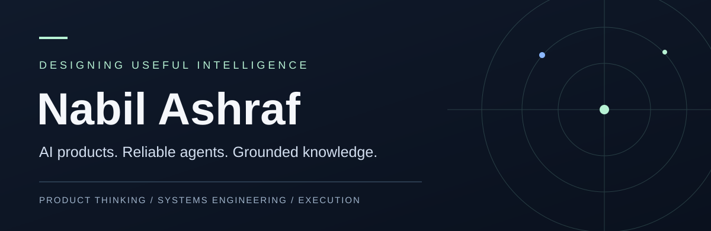

 

### AI Product Engineering · Agentic AI · RAG Systems · Intelligent Automation

**I work at the intersection of enterprise technology, product thinking, and applied AI.**

From navigating complex operational challenges to building intelligent software, I’m interested in one question: **How do we make technology genuinely useful?**

[**Explore selected work ↓**](#selected-work) &nbsp;·&nbsp; [**Connect on LinkedIn ↗**](https://www.linkedin.com/in/inabilashraf/) &nbsp;·&nbsp; [**Repositories ↗**](https://github.com/imnashraf?tab=repositories)

---

### 01 / A little about me

My work spans two complementary worlds:

**Enterprise technology & transformation.** I work with cross-functional business and technology teams on enterprise systems and operational change, including Oracle Fusion Cloud implementation activities across HR, finance, and supply chain. This brings firsthand exposure to integrations, delivery dependencies, user acceptance, governance, and the gap between a system that *works* and one people can actually depend on.

**Applied AI & product engineering.** I build and experiment with intelligent applications: retrieval-grounded assistants, autonomous workflows, Model Context Protocol (MCP) integrations, and products that turn fragmented information into decisions.

I’m especially drawn to difficult, overlooked problems—not AI added for novelty, but AI that makes a complex task clearer, faster, or more trustworthy.

### 02 / Selected work

<table>
<tr>
<td width="50%" valign="top">

#### [Recipe Research Agent ↗](https://github.com/imnashraf/recipe-research-agent)

**Agentic workflows / LangGraph / MCP / Python**

A controlled agent pipeline that converts recipe pages into structured nutrition research records. Built around explicit state, bounded retries, source provenance, and transparent partial results.

**Engineering evidence:** A documented 25-recipe run; 263 of 309 ingredient lines matched to a USDA food identifier (85.1%). Results have meaningful coverage limits.

[**Read the case study →**](https://github.com/imnashraf/recipe-research-agent#readme)

</td>
<td width="50%" valign="top">

#### [NutriAI ↗](https://github.com/imnashraf/ai-nutrition-assistant)

**AI product / RAG / Next.js / Groq**

A conversational nutrition guidance product designed around retrieved context, scope boundaries, structured responses, and a simple user experience.

**Engineering focus:** Retrieval orchestration, API validation, persisted conversations, and evidence visibility.

[**Explore the application →**](https://ai-nutrition-assistant-ten.vercel.app)

</td>
</tr>
<tr>
<td width="50%" valign="top">

#### [Nutrition Intelligence ↗](https://github.com/imnashraf/Nutrition-Intelligence)

**Evidence-first RAG / semantic search / Pinecone**

A bounded knowledge assistant designed to ground dietary guidance in curated documents, with retrieval thresholds and explicit refusal for unsupported topics.

**Engineering focus:** Source traceability and limiting unsupported generation.

[**Explore the application →**](https://nutritionintelligence.vercel.app)

</td>
<td width="50%" valign="top">

#### [Weekly App Review Pulse ↗](https://github.com/imnashraf/Weekly-App-Review-Pulse)

**Intelligent automation / analytics / Python**

Transforms public app reviews into a concise report of customer themes, evidence-backed quotes, and suggested actions.

**Engineering focus:** Privacy-aware processing, validation gates, resumable stages, and scheduled reporting.

[**Explore the application →**](https://weekly-app-review-pulse-zvhr3mv7zz7kk87mavs9fh.streamlit.app/)

</td>
</tr>
</table>

#### [Universal Google Workspace MCP Server ↗](https://github.com/imnashraf/MCP-Server)

An MCP integration layer for Gmail and Google Docs with OAuth authorization, restricted write operations, idempotency safeguards, and transport-independent design. A practical exercise in building tools that do more than generate text—they act, with boundaries.

---

### 03 / How I think about engineering

> **A polished demo tells you what a system can do. Its edge cases tell you whether it can be trusted.**

My recurring interests are:

- **Problem before technology** — Start with the user, workflow, constraints, and the reason the problem exists.
- **Evidence over confident answers** — Build retrieval, traceability, evaluation, and appropriate refusal into AI systems.
- **Control over autonomy** — Give agents explicit states, limits, observable outputs, and safe failure paths.
- **Delivery over abstraction** — Design for integration, deployment, maintenance, and real operational use.
- **Product experience matters** — Intelligent technology should feel intuitive, not complicated.

### 04 / Tools and technologies

| Focus | Technologies and approaches |
| :--- | :--- |
| **AI systems** | RAG, LangGraph, Groq, LLM workflows, embeddings, structured output, evaluations |
| **Agent tooling** | Model Context Protocol (MCP), tool orchestration, controlled retries, validation |
| **Application engineering** | Python, TypeScript, JavaScript, Next.js, React |
| **Data & infrastructure** | PostgreSQL, Supabase, Pinecone, Vercel, Railway, GitHub Actions |
| **Enterprise technology** | Oracle Fusion Cloud implementation and cross-functional delivery |

*The technologies above represent project exposure, not a claim of equal depth in every tool.*

---

### 05 / Let's build something meaningful

I enjoy connecting with **founders, product builders, engineering teams, and recruiters** working on applied AI, enterprise intelligence, agentic systems, and products built around real customer needs.

Whether you’re building something new, exploring an AI use case, or discussing an engineering opportunity, I’m open to thoughtful conversations.

**Have a problem worth solving?**

[**Let's connect on LinkedIn ↗**](https://www.linkedin.com/in/inabilashraf/)

Based in the United Arab Emirates · Enterprise technology × Applied AI

